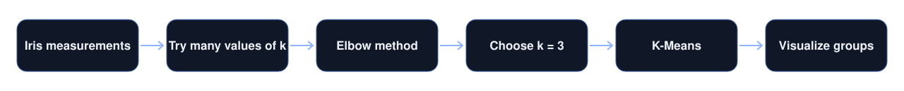
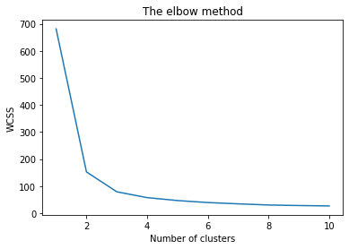
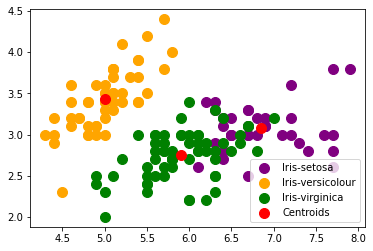
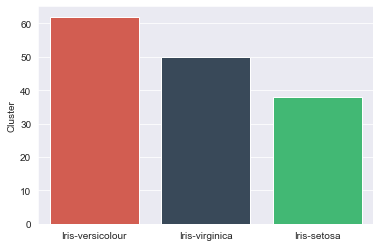
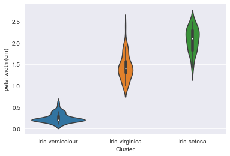

> Without being told the species, K-Means finds three natural groups of Iris flowers.

**Training project · Data Science & Business Analytics track**  
**Tools:** Python, scikit-learn, pandas, Matplotlib, Seaborn

## The challenge

How many groups does a dataset really contain, when nobody labels it for you?

## The data

The Iris dataset: 150 flowers with 4 measurements each. The species labels were not used for clustering.

## How it works

1. Measured the fit for different numbers of clusters.
2. Used the elbow method to choose 3.
3. Trained K-Means and explored the groups with 2D, 3D, and pair plots.

## A closer look

- **Choosing k:** within-cluster error was plotted against the number of clusters, then read at the elbow.
- **Clustering:** K-Means with 3 clusters.
- **Exploring:** 2D and 3D scatter plots, violin plots, and pair plots.

## Key decisions

- The elbow method makes the choice of 3 visible and easy to check.

## Results

| Measure | Result |
|---|---|
| Best number of clusters | **3** |
| Cluster sizes | **62 · 50 · 38** |

## Visual results

*The elbow method points to 3 clusters*

*The three clusters and their centers*

*Cluster sizes*

*Petal width across clusters*

## Programming skills

- Python programming
- Data handling with pandas
- K-Means clustering with scikit-learn
- Choosing parameters with the elbow method
- 2D and 3D data visualization

## Good to know

- The real dataset has 50 flowers per species, so the 62 and 38 show where two similar species overlap.

## What I would do next

- Compare with a silhouette score.
- Measure agreement with the true species.

<strong>بالعربي: تجميع أزهار السوسن</strong>

بدون معرفة الأنواع، تجد K-Means ثلاث مجموعات طبيعية للأزهار، وحددت طريقة المرفق هذا العدد.

**ملاحظة:** البيانات الحقيقية 50 زهرة لكل نوع، لذلك يبين 62 و38 تداخل نوعين متشابهين.

**المهارات البرمجية:** Python programming، Data handling with pandas، K-Means clustering with scikit-learn، Choosing parameters with the elbow method، 2D and 3D data visualization.

الكود خاص، وهذه الصفحة تعرض فكرة المشروع وطريقة عمله ونتائجه.

---

**About the source code:** the code for this project is private. This page presents what it does, how it works, and its results. To talk about the work, contact me through my [GitHub profile](https://github.com/SamerAlTaki97).
